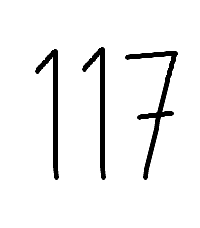
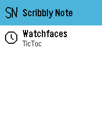

# Scribbly Note

**A one-time handwritten note for your Pebble Time 2.** Write something on the
touchscreen with your finger, and it's there the next time you open the app.

<p>
  
  &nbsp;
  
</p>

## Why?

You're at the gym. You put your stuff in locker 117, close the door, and walk off
to the weights. An hour later: was it 117? 171? 711?

With Scribbly Note you open the app, scribble **117** with your finger, and press
SELECT. That's it. When you're done working out, open the app and your locker
number is right there.

It works for anything you need to remember for a short while: a parking spot, a
door code, a table number, a short shopping list.

## How it works

There is only ever **one** note. Writing a new one replaces the old one. No
lists, no folders, nothing to clean up.

| Screen | Button | What it does |
|---|---|---|
| Viewing your note | **SELECT** | Start a new note (the old note is erased) |
| | **BACK** | Close the app |
| Writing | *finger* | Draw on the screen |
| | **UP** | Undo the last stroke |
| | **SELECT** | Done, back to viewing |

- **Opening the app shows your last note.** While you're viewing it, touching
  the screen does nothing, so you can't scribble over your note by accident.
- **When there's no note yet**, the app opens straight into writing mode.
- **Your note is saved after every stroke.** If you close the app halfway
  through writing, nothing is lost.
- **Everything stays on the watch.** No phone connection, no account, no
  internet needed.

## Compatibility

Scribbly Note needs a touchscreen, so it runs on **Pebble Time 2** only.

A note has room for roughly 1,500 points of ink. That's plenty for numbers and a
few words, but not for an essay. Once it's full, extra strokes aren't recorded.

## Install

Get it from the Pebble appstore, or build it yourself (see below).

---

## Development

Built in C with the [Pebble SDK](https://developer.repebble.com).

```sh
pebble build                          # build the .pbw (build/pebble-scribbly-note.pbw)
pebble install --emulator emery       # run it in the Pebble Time 2 emulator
pebble install --phone <phone-ip>     # install on your watch via the phone's Developer Connection
```

### Project layout

```
src/c/scribbly-note.c     the whole app
resources/images/icon.png 25×25 menu icon
docs/screenshots/         emery screenshots (200×228), used here and in the appstore
docs/store-listing.md     text for the appstore listing
package.json              app metadata: name, UUID, version, platforms, resources
```

### How the note is stored

The note is a list of touch points (`x`, `y` as one byte each) with a marker
between strokes. It's redrawn as lines every time the screen updates, and saved
with the persistent storage API in 256-byte chunks (Pebble's per-key limit).

### Testing touch in the emulator

The `pebble` tool has no command for simulating touch, and the QEMU monitor's
`mouse_move` sends relative movement, which the emulator's absolute touch device
ignores. Clicking and dragging with the mouse in the emulator window does work,
and you can script that with X11 pointer events.

## License

MIT, see [LICENSE](LICENSE).
